# jarvis-voice-assistant

跑在自己 Mac 上的本機語音助理「賈維斯」——**一直聽、你問才答、全程不上雲**。
耳朵用 NVIDIA Nemotron ASR，腦用 Claude Code CLI，嘴用本機 Breeze-TTS-2 台灣口音男聲。
在 Apple Silicon（M4 Pro / 48GB）實測可用。

> 這份是去個人化後的公開備份：**不含**任何 bot token、chat_id、對話 log、個人路徑或
> 個人語音錄音。照著 README 把 `YOUR_USERNAME` 等佔位符換成你自己的值。

## 架構（四個零件）

```mermaid
flowchart TD
    Mic["🎙️ 麥克風<br/>sounddevice + Silero VAD<br/>一直聽・濾雜音"]
    Wake["⏰ 喚醒詞<br/>openwakeword｜hey jarvis"]
    ASR["🦻 耳朵 STT<br/>NVIDIA Nemotron 3.5<br/>MLX・本機"]
    VOCAB[("📒 字庫 VOCAB<br/>hotwords 專有名詞")]
    Brain["🧠 腦<br/>claude -p --strict-mcp-config<br/>快腦判斷：答／等／略過／深想"]
    Decide{"是在跟它說話<br/>而且講完了？"}
    Skip["🤐 輸出 &#91;&#91;SKIP&#93;&#93;<br/>不出聲"]
    TTS["🗣️ 嘴 TTS<br/>Breeze-TTS-2 台灣口音<br/>MLX・本機・逐句串流"]
    Speaker["🔊 喇叭<br/>第一聲約 1 秒"]

    Mic --> Wake --> ASR --> Brain
    VOCAB -. 餵詞 .-> ASR
    Brain --> Decide
    Decide -- 否 --> Skip
    Decide -- 是 --> TTS --> Speaker
```



> 收音、辨識（耳）、判斷（腦）、合成（嘴）**全在自己的 Mac 上跑，不上雲**。
> 腦用 `--strict-mcp-config` 開，不載入任何 MCP 外掛，所以不會跟常駐的 Telegram bot 搶連線。

| 零件 | 用什麼 | 說明 |
|------|--------|------|
| 👂 收音 | `sounddevice` + Silero VAD | 一直聽麥克風；打字聲、風扇、電視雜音靠 VAD 濾掉 |
| 🦻 耳朵（STT） | **NVIDIA Nemotron 3.5 Transcribe**（MLX，本機） | 帶「字庫」hotwords，品牌／技術詞聽得準；常駐記憶體 |
| 🧠 腦 | `claude -p --strict-mcp-config`（常駐 stream-json） | 快腦先判斷（答／等／略過／深想），需要深思才交給大模型 |
| 🗣️ 嘴（TTS） | **Breeze-TTS-2**（MLX，本機，台灣口音） | 用一段參考錄音複製音色，逐句串流合成，第一聲約 1 秒 |

**一直聽的邏輯**：腦每次收到一段話先判斷——是不是在跟它說話？講完了沒？要不要深想？
不是對它說的（自言自語、講電話、電視聲）就輸出 `[[SKIP]]` 不出聲。
說「賈維斯暫停」只等喚醒詞、「賈維斯關機」結束。

**不搶 Telegram 連線**：腦用 `--strict-mcp-config` 開，不載入任何 MCP 外掛，
所以就算你同時有一個 Telegram bot 常駐，兩邊也不會搶 long-poll。

## 需要先裝的東西

- macOS（Apple Silicon 佳）、Python 3.12
- [Claude Code CLI](https://claude.com/claude-code)（`claude` 在 PATH 上）
- `brew install portaudio ffmpeg`
- Nemotron ASR 環境：建一個 venv，裝 `mlx`, `mlx-audio[stt]`，下載
  `divergentlabs/Nemotron-3.5-Transcribe-30B-A4B-MLX`（4-bit，約 15GB）。
  本專案假設它在 `~/nemotron-asr-test/`，jarvis 跟它共用 venv 與模型。
- 語音合成模型：`mlx-community/Breeze-TTS-2-mlx-8bit`（首次 `load_model` 會自動下載）
- venv 內再裝：`openwakeword`, `sounddevice`（喚醒詞/VAD 用到 openwakeword 內建的
  `hey_jarvis_v0.1.onnx` 與 `silero_vad.onnx`）

## 安裝步驟

1. 把這個 repo 放到 `~/jarvis/`。
2. **做一段參考聲音** `voices/jarvis_ref.wav`：見 [`voices/README.md`](voices/README.md)
   （跑 `make_ref_voice.py` 挑一個喜歡的，重新命名成 `jarvis_ref.wav`）。
   `jarvis.py` 裡的 `TTS_REF` 和 `TTS_REF_TEXT` 要對得起來（參考音檔＋它念的那句話）。
3. 傳 Telegram 給自己是**選用**功能。要用的話，`jarvis.py` 會讀
   `~/.claude/channels/telegram/.env`（`TELEGRAM_BOT_TOKEN=...`）和同目錄
   `access.json`（`allowFrom[0]` 當 chat_id）。不想用就不會影響語音功能。
4. 開機自動啟動：把 `launchd/com.example.jarvis.plist.template` 複製成
   `~/Library/LaunchAgents/com.YOUR_USERNAME.jarvis.plist`，把裡面的 `YOUR_USERNAME`
   換成你的，然後 `launchctl bootstrap gui/$(id -u) <plist>`。
5. 第一次要在「系統設定 → 隱私權 → 麥克風」允許那個 python。

## 跑起來 / 重啟

```bash
# 直接跑（看 log）
~/nemotron-asr-test/.venv/bin/python -u ~/jarvis/jarvis.py

# 或用 launchd 重啟
launchctl kickstart -k gui/$(id -u)/com.YOUR_USERNAME.jarvis
# 也可以雙擊 start-jarvis.command
```

對麥克風講話即可（例如「現在幾點」「RX 是什麼意思」）。改完 `jarvis.py` 要
`kickstart -k` 才生效，不要再手動另開一份（會同時跑兩個）。

## 調「字庫」聽得更準（重要）

`jarvis.py` 最上面的 `VOCAB` 是餵給 Nemotron 的 hotwords。把你常講的專有名詞、
品牌、技術詞加進去，耳朵就聽得準。**實測心得**：清楚發音的英文詞字庫就抓得到；
但「單獨蹦一個很短的英文縮寫」（例如只講「RX」）因為沒有前後文，模型容易掉進
中文諧音——解法是用短句問（「RX 是什麼意思」），辨識率高很多。

## 隱私 / 安全

- 全程本機：收音、辨識、合成都不上雲（腦是本機的 `claude` CLI）。
- 這個 repo **不含**對話 log、`.env`、`access.json`、個人語音錄音、個人路徑。
- `.gitignore` 已擋掉 `*.log`、`run.*`、`.cache_*`、`*.wav`、`*.plist`（範本除外）等。

## 授權

- 本 repo 的程式碼：MIT。
- 相依模型各有授權：**Breeze-TTS-2 僅限非商業用途**、Nemotron 與 Claude 依其各自條款。
  `voices/demo_*.ogg` 是用 Breeze-TTS-2 生成的示範音，僅供試聽，商業使用請遵守模型授權。
